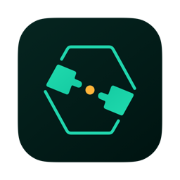
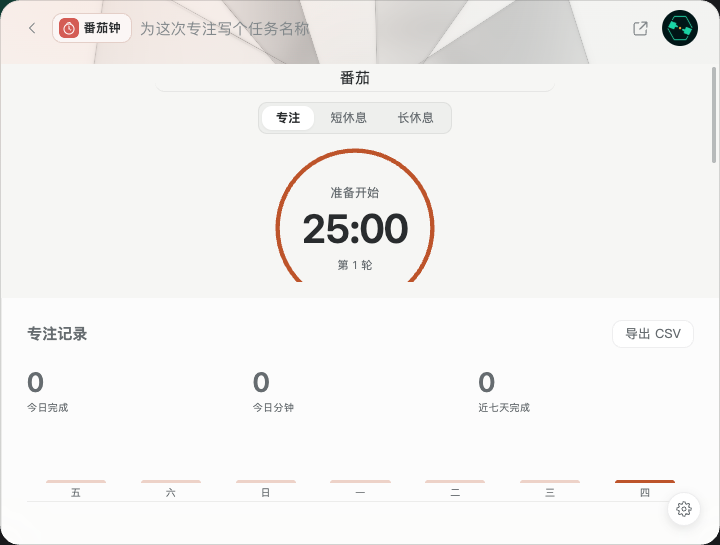
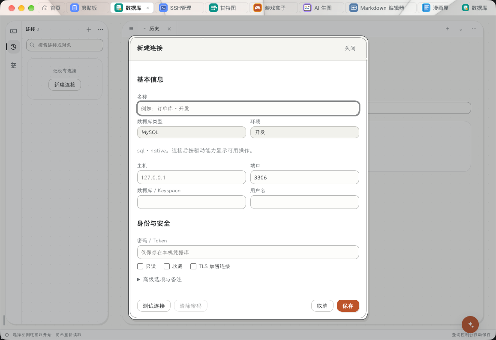
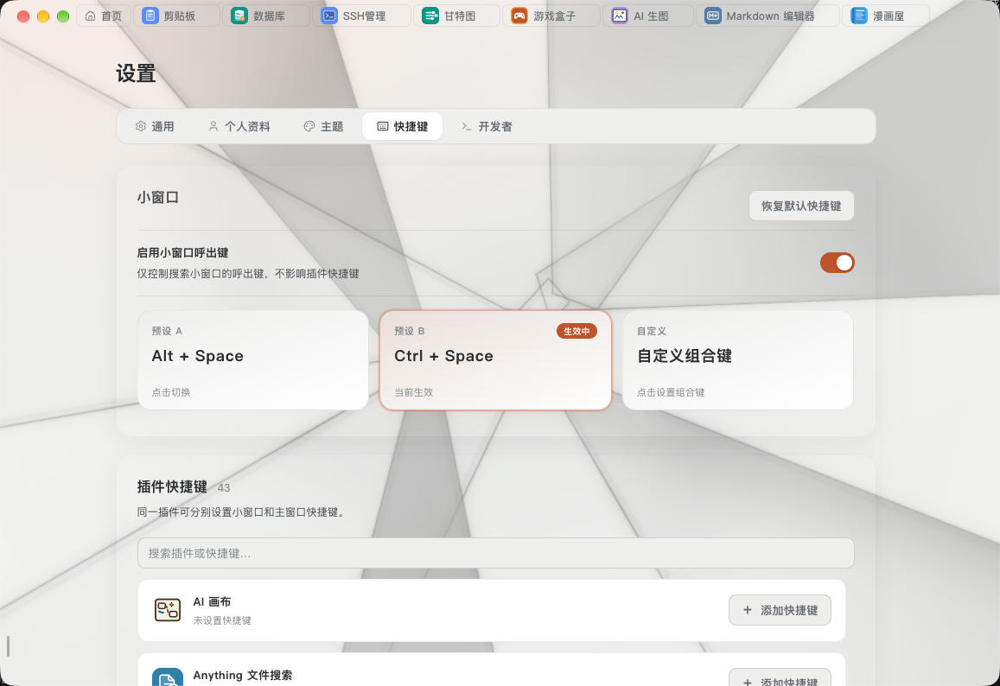
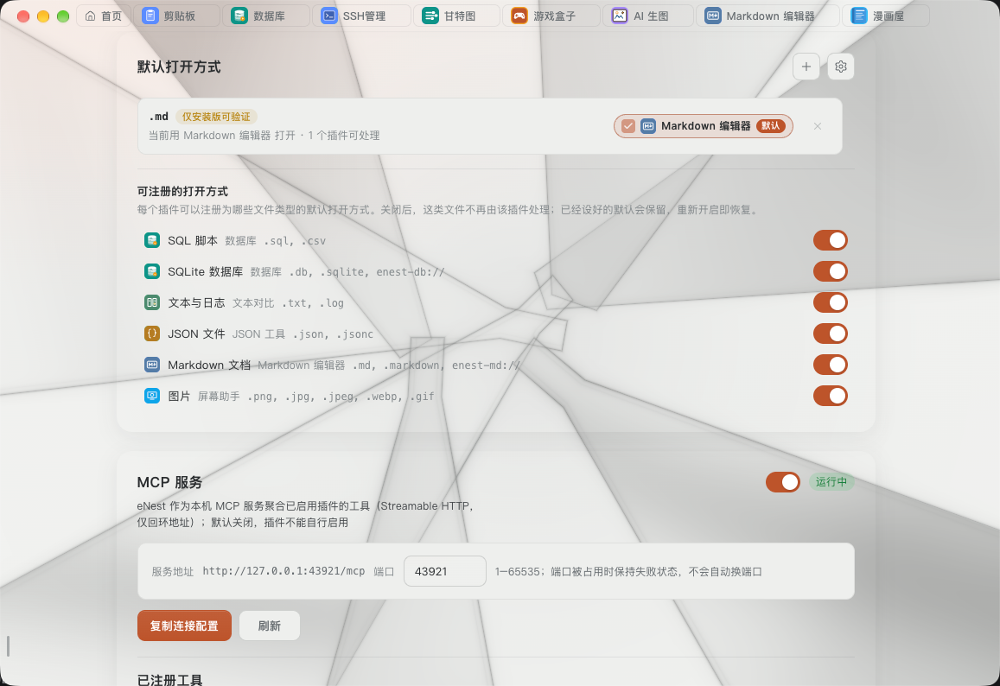
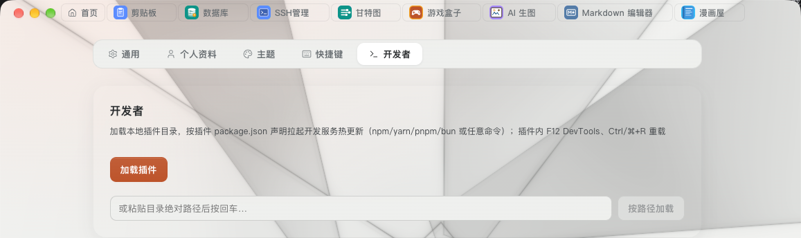

<p align="center">
  <a href="https://hyqf98.github.io/eNest/"></a>
</p>

<h1 align="center">eNest</h1>
<p align="center">开源桌面插件工具箱</p>

<p align="center">
  <a href="https://github.com/hyqf98/eNest/actions/workflows/build.yml"></a>
  <a href="#从源码启动"></a>
  <a href="LICENSE"></a>
</p>

<p align="center">
  <a href="https://hyqf98.github.io/eNest/"><strong>访问 eNest 官网</strong></a> · <a href="#从源码启动">从源码启动</a> · <a href="https://hyqf98.github.io/eNest/plugin/">插件开发指南</a> · <a href="https://github.com/hyqf98/eNest_plugin">官方插件仓库</a>
</p>

<p align="center">
  <a href="assets/readme/quick-screen-assistant.png" title="查看屏幕助手截图"></a> &nbsp;
  <a href="assets/readme/quick-pomodoro.png" title="查看番茄钟截图"></a> &nbsp;
  <a href="assets/readme/desktop-database-connection.png" title="查看数据库截图"></a> &nbsp;
  <a href="assets/readme/desktop-game-box.png" title="查看游戏盒子截图"></a> &nbsp;
  <a href="assets/readme/desktop-comic-house.png" title="查看漫画屋截图"></a>
</p>

临时截一张图、开一轮番茄钟，用快捷键呼出 **Quick 小窗口**就够了。需要边查数据库边写笔记时，把数据库和 Markdown 编辑器放在**桌面主窗口**的两个标签页里，随时切换。

## 桌面主窗口与插件市场

首页就是插件市场。搜索工具名，或按「效率」「开发」「设计」等分类浏览；切到「已安装」，就只看自己装过的插件。打开的工具会排在窗口顶部：可以在数据库、剪贴板和编辑器之间切换，也可以把一个标签拖出去，变成独立窗口，与原来的工作并排放置，不必重新打开插件。


如果想把便笺、时钟留在桌面上，可以另装「自由画布」摆放浮动组件；想按区域收纳文件、设置壁纸和程序栏，则可以选「自由桌面」。这两个插件都不是使用主窗口或 Quick 的前提。

## Quick 小窗口

不用先切回 eNest 主窗口。在「设置 → 快捷键 → 小窗口」启用呼出键后，按一下就能看到搜索框和常用入口。点图标，或者输入应用名、插件名、指令后按回车。切回原来的应用时 Quick 会收起；再次呼出，还能接着用刚才的插件。


|  屏幕助手 |  番茄钟 |
| --- | --- |
| 选区域、全屏或长截图，决定截完是标注、复制还是贴图。需要录一段操作时，切到「录屏」。 | 在顶部写下这轮要做的事，开始 25 分钟专注。可以切换长短休息，查看专注记录并导出 CSV。 |
|  |  |

## 在主窗口里使用插件

这些工具按需安装。数据库用完整窗口放连接列表和查询页；游戏盒子和漫画屋则把空间留给封面、分类和搜索结果。

<details>
<summary> <strong>数据库</strong>：按环境管理连接，打开查询工作台</summary>

新建连接时可以取一个好认的名字，选择数据库类型和环境，再填写主机与身份信息。图中是尚未连接的 MySQL 配置页，保存前可以测试连接，也可以勾选只读或 TLS。



</details>

<details>
<summary> <strong>游戏盒子</strong>：按平台找游戏，管理自己的游戏和下载</summary>

在「发现」里切换 PC 或主机游戏，按名称搜索、按分类筛选。点封面右上角的心形可以收藏；「我的游戏」和「下载管理」有各自的入口。


</details>

<details>
<summary> <strong>漫画屋</strong>：跨来源搜索，按榜单挑一部漫画阅读</summary>

知道书名可以直接搜；想找新作，可以在「发现」里切换来源，按最近七天、最近三十天或总榜浏览。选中封面后再挑章节阅读。


</details>

## 快捷键与系统集成

**快捷键注册。** 新装时，小窗口呼出键默认关闭，不会抢占系统组合键。开启后可选 `Alt + Space`（Mac 上是 `Option + Space`）、`Ctrl + Space`，或录入自己的组合，以设置页标记的「生效中」为准。插件快捷键单独配置，同一插件可以为小窗口和主窗口分别绑键。

<details>
<summary>查看快捷键设置：呼出键预设与插件绑定</summary>



</details>

**默认打开方式。** 在「设置 → 通用」中，可以让 `.md` 交给 Markdown 编辑器、让 `.json` 交给 JSON 工具。候选来自已安装插件声明的文件类型；操作系统的默认应用关联需在安装版中按系统流程确认。

**本机 MCP 服务。** 同一页可以开启服务、查看状态、复制客户端连接配置，并查看已启用插件注册了哪些工具。服务默认关闭，只监听本机回环地址；客户端调用不会替插件取得新权限。

<details>
<summary>查看通用设置：默认打开方式与 MCP 管理</summary>



</details>

## 安装与运行

目前公开发行已暂停，体验桌面端请从源码启动。可在[官网查看下载说明](https://hyqf98.github.io/eNest/download.html)；恢复发行后，以 [GitHub Releases](https://github.com/hyqf98/eNest/releases) 的实际附件为准。GitHub 自动生成的 Source code 压缩包不是安装包。

### 从源码启动

需要 Git 和 Node.js **22.12.0 或更新版本**。仓库使用 npm 锁文件；CI 打包使用 Node.js 24。

```bash
git clone https://github.com/hyqf98/eNest.git
cd eNest
npm ci
npm run dev
```

启动前的脚本会准备 Electron 和本机辅助程序。macOS 需要 Xcode Command Line Tools；Linux 需要编译器及相关开发库，具体依赖见 [构建工作流](.github/workflows/build.yml)。没有安装对应工具链时，先补齐环境，再运行开发命令。

### 常用命令

| 命令 | 用途 |
| --- | --- |
| `npm run dev` | 启动桌面开发环境 |
| `npm run dev:debug` | 启动开发环境，并开放本机 CDP 调试端口 9331 |
| `npm run typecheck` | 检查主进程、preload 和页面的 TypeScript 类型 |
| `npm run audit:contracts` | 静态检查插件 API、权限与 IPC 分发契约 |
| `npm run audit:source` | 静态检查源码、测试夹具和插件的职责边界 |
| `npm run build` | 构建应用与许可证文件，输出到 `out/` |
| `npm run audit:source -- --build-output` | 检查构建产物中的夹具标记与 preload 依赖 |
| `npm run pack:dir` | 生成当前平台的未打包应用目录 |
| `npm run dist` | 生成当前平台安装包，不上传发布 |

主进程或 preload 改动后需要重启开发进程；页面开发支持 HMR。用例入口和隔离数据要求见 [tests/README.md](tests/README.md)。

打包配置在 [electron-builder.yml](electron-builder.yml)。原生辅助程序从 `src/native/` 构建到 `.cache/native/bin/`，安装包仍放在应用资源的 `native/` 目录下。CI 使用各平台的原生构建任务，只有 `v*` 标签触发公开发布，手动构建不会自动发布。签名、更新元数据和跨平台打包说明见 [发布工具文档](scripts/packaging/README.md)。设置页支持通过默认浏览器登录 GitHub，选择插件备份到自己的私库或在另一台电脑恢复；发布者的一次性配置、自动建库及恢复范围见 [GitHub 登录与私库同步](scripts/auth/README.md)。

## 开发自己的插件

插件是一个 Web 页面，加上一份 `plugin.json` 清单。可以使用 React、Vue 或原生 JavaScript，通过 `window.enest` 调用通知、私有存储、文件选择、快捷键等宿主能力，不需要把业务写进 Electron 主进程。

按[插件快速开始](docs/site/plugin/getting-started.md)创建插件后，到「设置 → 开发者」点击「加载插件」，选择包含 `plugin.json` 的源码目录，也可以直接粘贴目录路径。加载后可在「开发中」列表启动调试；使用 Vite 的插件可以在桌面窗口里看到热更新。



官方插件、SDK、共享组件和构建工具在独立的 [eNest_plugin 仓库](https://github.com/hyqf98/eNest_plugin)。如果要联调官方插件或生成 SDK，将它克隆到宿主根目录下：

```bash
git clone https://github.com/hyqf98/eNest_plugin.git eNest_plugin
```

这个目录不纳入宿主 Git。插件仓库有自己的依赖与构建步骤，按它的 README 操作即可；只运行宿主不要求检出全部插件源码。

插件也可以贡献主题或 MCP 工具。向其他用户分发时应提供 `.enestplugin` 或符合插件包结构的 `.zip`；仓库的源码 ZIP 不能直接当作插件安装。

| 入口 | 内容 |
| --- | --- |
| [开发文档导航](docs/site/plugin/README.md) | 官方指南与示例入口 |
| [工程格式](docs/site/plugin/structure.md) / [plugin.json](docs/site/plugin/manifest.md) | 源码目录、插件清单与发布包 |
| [API](docs/site/plugin/api.md) / [TypeScript 类型](docs/site/plugin/api-types.md) | 宿主接口与 SDK 类型 |
| [存储](docs/site/plugin/storage.md) / [权限](docs/site/plugin/permissions.md) | 记录、图片、文件输出与授权 |
| [多布局适配](docs/site/plugin/dual-mode-tools.md) / [生命周期](docs/site/plugin/lifecycle.md) | Quick、主窗、独立窗与实例回收 |
| [主题](docs/site/plugin/themes.md) / [设置与窗口](docs/site/plugin/settings-and-windows.md) | 自定义呈现和设置页面 |
| [Node 后端](docs/site/plugin/backend.md) / [MCP](docs/site/plugin/mcp.md) | 本机业务后端与工具调用 |

## 数据与权限

默认数据目录是 `~/.eNest`，可以在设置中更换。插件的记录、图片资源和输出文件按插件隔离，同一插件在不同窗口使用同一份数据。这是本地存储，不是云同步。

插件页面没有 Node.js 权限。网络、剪贴板和系统控制等能力需要相应授权；用户文件通过宿主选择器和文件句柄访问，知道一个路径并不等于获得读取权限。主题也不能替代账号、权限、文件选择等原生确认。

有些插件需要 `backend.node` 来运行本机 Node.js 后端。这项授权允许执行完整的本机代码，不受页面沙箱限制，请只授予你信任的插件。详见 [权限说明](docs/site/plugin/permissions.md) 和 [后端说明](docs/site/plugin/backend.md)。

## 仓库结构

宿主使用 Electron、React 和 TypeScript，业务代码留在插件仓库中。

```text
src/main          原生宿主与通用服务
src/preload       最小安全桥
src/renderer      壳控制器、共享 UI 与默认主题
src/shared        跨端契约、常量和纯模型
src/native        原生剪贴板与平台辅助程序源码
tests             用例、夹具与开发预览
docs/site         产品官网与官方插件 API
scripts           构建发布工具、静态审计与发布者示例
assets/icons      运行时图标
build             打包图标和系统关联声明
eNest_plugin      独立插件仓库，不纳入宿主 Git
```

## 反馈与贡献

遇到问题可以提交 [Issue](https://github.com/hyqf98/eNest/issues)。请写明操作系统与处理器架构、eNest 和插件版本，以及能复现问题的步骤；截图和脱敏日志也有帮助。某个插件自身的问题，可以提交到 [插件仓库](https://github.com/hyqf98/eNest_plugin/issues)。

修复问题、补充文档和改进插件都欢迎。较大的功能或接口调整，建议先开 Issue 讨论。修改宿主前请阅读 [AGENTS.md](AGENTS.md)；维护官网可参考 [网站说明](docs/site/README.md)。提交日志或截图前，请去掉令牌、个人文件路径和连接信息。

## 许可证

eNest 宿主采用 [Apache License 2.0](LICENSE)。插件和第三方依赖遵循各自的许可证。
