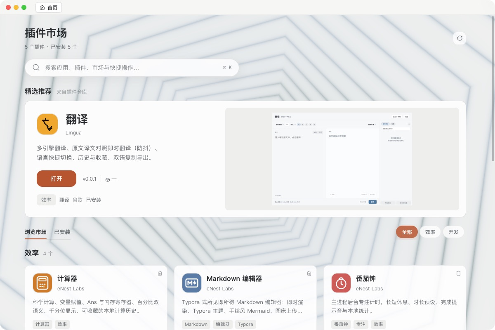
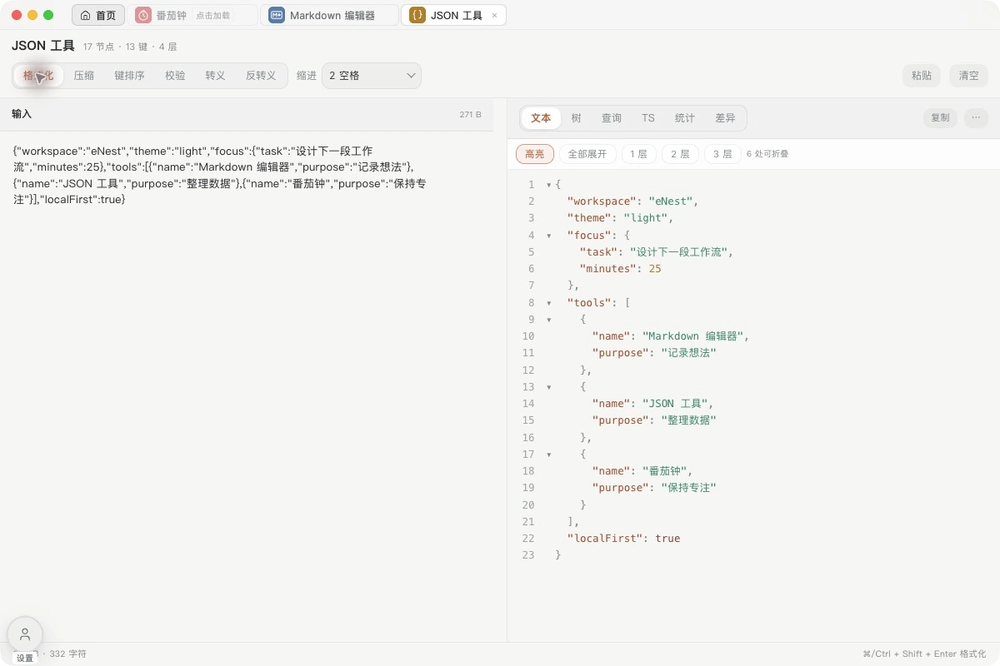

# eNest

eNest 是一个开源的桌面插件工具箱。用 Quick 搜索插件和本机应用，在小窗口里处理临时任务；需要长时间使用的工具，可以留在主窗口标签页里，也可以拆成独立窗口。

工具按需安装，界面可以换主题。翻译、Markdown、JSON、数据库等具体功能由插件提供，eNest 负责安装、窗口、快捷键、权限和数据存储。

[产品官网](https://hyqf98.github.io/eNest/) · [插件开发文档](https://hyqf98.github.io/eNest/plugin/) · [GitHub Releases](https://github.com/hyqf98/eNest/releases) · [反馈问题](https://github.com/hyqf98/eNest/issues)



截图来自 macOS 开发实例，使用独立演示数据；界面可能随开发更新。

<!-- workspace.jpg: native Electron JPEG capture, 2026-10-30, source 0.2.3, five existing demo plugin builds. -->

## 怎么用

### 临时用一下：Quick

Quick 呼出键默认开启，可以在「设置 → 快捷键 → Quick 呼出键」调整。默认候选是 `Alt/Option + Space` 和 `Ctrl + Space`，只启用当前注册成功的一组；被系统或其他软件占用时，可以换一组。

呼出后输入应用名、插件名或触发词，选中结果并按回车。默认主题支持拼音检索；插件也可以把自己的功能入口放进搜索结果。宿主提供前缀文本输入接口，例如可把 `fy hello` 中的 `hello` 交给翻译入口，具体填入和执行行为需要插件适配。

进入插件后，切换到其他软件会收起 Quick，再次呼出仍停留在该插件。按 Esc 或点击返回按钮回到搜索；终端、编辑器和弹层可以自行处理 Esc。插件是否接管顶部输入框、如何处理传入内容，由插件决定。


<!-- quick.jpg: native Electron JPEG capture, 2026-10-30, task text entered through the host input. JSON capture: 2026-10-29; provenance in docs/site/assets/ASSETS.md. -->

### 持续工作：标签页和独立窗口

主窗口可以同时保留多个插件标签。想把编辑器和另一个工具并排放置，可以把插件标签拖出主窗口，变成独立窗口；从 Quick 中也可以固定到主窗口继续使用。窗口移动沿用原来的插件实例，不必重新打开一份。

自由面板适合常驻的计时器等小组件。在「设置 → 主题 → 自由面板」开启后，点击「框选并新建」，选择区域、添加组件，再调整位置和大小。布局会保存；只有声明了组件视图的插件才能加入面板，并非每个插件都支持这种用法。

面板默认透明，不给插件再套一层卡片。已有面板如果保留了底板颜色或毛玻璃，可以在同一设置区点击「设为透明」；也可以保留自己选的材质。



### 安装工具，调整外观

在插件目录中查看介绍并安装需要的工具。本地发布包也可以直接拖入 eNest，支持 `.enestplugin` 和符合插件包结构的 `.zip`；GitHub 下载的源码 ZIP 不能直接安装。

默认主题随软件提供，不需要单独下载。第三方主题可以更换首页、Quick、窗口导航和设置页的呈现。插件自己的设置既可以放在宿主设置页，也可以在插件内打开。

常用插件还可以绑定独立快捷键。支持文件打开入口的插件可在「打开方式」中配置。系统默认应用的注册和状态验证需要打包安装版，并遵循操作系统的设置流程。

## 安装与运行

当前源码版本为 **0.0.1**，正在准备首次公开发行。安装包发布前可从源码运行；实际可下载的附件和版本说明以 [GitHub Releases](https://github.com/hyqf98/eNest/releases) 为准。

构建目标是 macOS arm64/x64、Windows x64 和 Linux x64。各平台的可用安装包、系统要求及限制，以对应 Release 的附件和说明为准。

### 从源码启动

需要 Git 和 Node.js **22.12.0 或更新版本**。仓库使用 npm 锁文件；CI 打包使用 Node.js 24。

```bash
git clone https://github.com/hyqf98/eNest.git
cd eNest
npm ci
npm run dev
```

启动前的脚本会准备 Electron 和本机辅助程序。macOS 需要 Xcode Command Line Tools；Linux 需要编译器及相关开发库，具体依赖见 [构建工作流](.github/workflows/build.yml)。没有安装对应工具链时，先补齐环境，再运行开发命令。

### 常用命令

| 命令 | 用途 |
| --- | --- |
| `npm run dev` | 启动桌面开发环境 |
| `npm run dev:debug` | 启动开发环境，并开放本机 CDP 调试端口 9331 |
| `npm run typecheck` | 检查主进程、preload 和页面的 TypeScript 类型 |
| `npm run audit:contracts` | 静态检查插件 API、权限与 IPC 分发契约 |
| `npm run audit:source` | 静态检查源码、测试夹具和插件的职责边界 |
| `npm run build` | 构建应用与许可证文件，输出到 `out/` |
| `npm run audit:source -- --build-output` | 检查构建产物中的夹具标记与 preload 依赖 |
| `npm run pack:dir` | 生成当前平台的未打包应用目录 |
| `npm run dist` | 生成当前平台安装包，不上传发布 |

主进程或 preload 改动后需要重启开发进程；页面开发支持 HMR。用例入口和隔离数据要求见 [tests/README.md](tests/README.md)。

打包配置在 [electron-builder.yml](electron-builder.yml)。CI 使用各平台的原生构建任务，只有 `v*` 标签触发公开发布，手动构建不会自动发布。签名、更新元数据和跨平台打包说明见 [发布工具文档](tools/packaging/README.md)；自行接入账号服务可参考 [发布者账号示例](tools/auth/README.md)。

## 开发自己的插件

插件是一个 Web 页面，加上一份 `plugin.json` 清单。可以使用 React、Vue 或原生 JavaScript，通过 `window.enest` 调用通知、私有存储、文件选择、快捷键等宿主能力，不需要把业务写进 Electron 主进程。

从 [插件快速开始](docs/site/plugin/getting-started.md) 创建一个最小插件，再到「设置 → 开发者 → 加载插件」选择包含 `plugin.json` 的源码目录。官方插件、SDK、共享组件和构建工具在独立的 [eNest_plugin 仓库](https://github.com/hyqf98/eNest_plugin)。如果要联调官方插件或生成 SDK，将它克隆到宿主根目录下：

```bash
git clone https://github.com/hyqf98/eNest_plugin.git eNest_plugin
```

这个目录不纳入宿主 Git。插件仓库有自己的依赖与构建步骤，按它的 README 操作即可；只运行宿主不要求检出全部插件源码。

插件还可以贡献主题或 MCP 工具。本机 MCP 服务默认关闭，调用不会替用户授权或弹出文件选择器，接入前请阅读对应指南。

| 入口 | 内容 |
| --- | --- |
| [开发文档导航](docs/site/plugin/README.md) | 官方指南与示例入口 |
| [工程格式](docs/site/plugin/structure.md) / [plugin.json](docs/site/plugin/manifest.md) | 源码目录、插件清单与发布包 |
| [API](docs/site/plugin/api.md) / [TypeScript 类型](docs/site/plugin/api-types.md) | 宿主接口与 SDK 类型 |
| [存储](docs/site/plugin/storage.md) / [权限](docs/site/plugin/permissions.md) | 记录、图片、文件输出与授权 |
| [多布局适配](docs/site/plugin/dual-mode-tools.md) / [生命周期](docs/site/plugin/lifecycle.md) | Quick、主窗、组件与实例回收 |
| [主题](docs/site/plugin/themes.md) / [设置与窗口](docs/site/plugin/settings-and-windows.md) | 自定义呈现和设置页面 |
| [Node 后端](docs/site/plugin/backend.md) / [MCP](docs/site/plugin/mcp.md) | 本机业务后端与工具调用 |

## 数据与权限

默认数据目录是 `~/.eNest`，可以在设置中更换。插件的记录、图片资源和输出文件按插件隔离，同一插件在不同窗口使用同一份数据。这是本地存储，不是云同步。

插件页面没有 Node.js 权限。网络、剪贴板和系统控制等能力需要相应授权；用户文件通过宿主选择器和文件句柄访问，知道一个路径并不等于获得读取权限。主题也不能替代账号、权限、文件选择等原生确认。

有些插件需要 `backend.node` 来运行本机 Node.js 后端。这项授权允许执行完整的本机代码，不受页面沙箱限制，请只授予你信任的插件。详见 [权限说明](docs/site/plugin/permissions.md) 和 [后端说明](docs/site/plugin/backend.md)。

## 仓库结构

宿主使用 Electron、React 和 TypeScript，业务代码留在插件仓库中。

```text
src/main          原生宿主与通用服务
src/preload       最小安全桥
src/renderer      壳控制器、共享 UI 与默认主题
src/shared        跨端契约、常量和纯模型
tests             用例、夹具与开发预览
docs/site         产品官网与官方插件 API
tools             构建发布工具与发布者示例
native            原生剪贴板与平台辅助能力
assets/icons      运行时图标
build             打包图标和系统关联声明
eNest_plugin      独立插件仓库，不纳入宿主 Git
```

## 反馈与贡献

遇到问题可以提交 [Issue](https://github.com/hyqf98/eNest/issues)。请写明操作系统与处理器架构、eNest 和插件版本，以及能复现问题的步骤；截图和脱敏日志也有帮助。某个插件自身的问题，可以提交到 [插件仓库](https://github.com/hyqf98/eNest_plugin/issues)。

修复问题、补充文档和改进插件都欢迎。较大的功能或接口调整，建议先开 Issue 讨论。修改宿主前请阅读 [AGENTS.md](AGENTS.md)；维护官网可参考 [网站说明](docs/site/README.md)。提交日志或截图前，请去掉令牌、个人文件路径和连接信息。

## 许可证

eNest 宿主采用 [Apache License 2.0](LICENSE)。插件和第三方依赖遵循各自的许可证。
